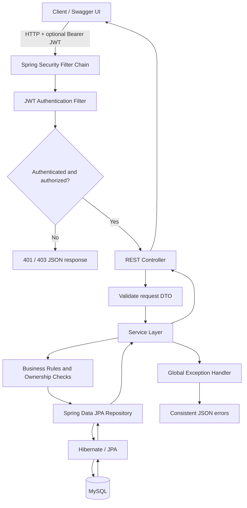

# WanderLust API

A Spring Boot REST API starter for **WanderLust**, a travel-stay marketplace. It provides account registration and login, JWT-based authentication, role-aware listing management, booking workflows, searchable/paginated listings, and consistent JSON errors.

> **Project status:** Core API scaffolding and main endpoints are implemented. Before treating this as production-ready, complete the security, database migration, concurrency, and testing improvements listed below.

## Table of contents

- [Overview](#overview)
- [Tech stack](#tech-stack)
- [Architecture](#architecture)
- [Features](#features)
- [API reference](#api-reference)
- [Local setup](#local-setup)
- [Docker Compose](#docker-compose)
- [Deploy to Railway](#deploy-to-railway)
- [Deploy to Render](#deploy-to-render)
- [Security notes](#security-notes)
- [Future improvements](#future-improvements)

## Overview

WanderLust separates HTTP handling, business logic, persistence, and security into distinct layers.

- **Authentication:** register and log in with an email/password; the API returns a signed JWT access token.
- **Authorization:** `USER` and `HOST` roles; a host can create listings, while listing updates/deletes also check ownership.
- **Listing discovery:** case-insensitive search by city/country, minimum/maximum nightly price, pagination, and an allowlist of sort fields.
- **Bookings:** authenticated guests can create and manage their own reservations, with date, guest-count, and overlap checks.
- **Error handling:** `@RestControllerAdvice` returns consistent JSON error responses.
- **API documentation:** Swagger UI and OpenAPI JSON/YAML are available through springdoc.

## Tech stack

| Area | Technology |
|---|---|
| Language | Java 17 |
| Framework | Spring Boot 3.5.x |
| Build | Maven |
| HTTP API | Spring Web / REST |
| Persistence | Spring Data JPA, Hibernate |
| Database | MySQL 8.x |
| Validation | Jakarta Bean Validation |
| Security | Spring Security, BCrypt, JWT (JJWT) |
| API documentation | springdoc-openapi / Swagger UI |
| Containerization | Docker, Docker Compose |
| Tests | JUnit 5, Mockito, Spring Boot Test |

## Architecture



### Source layout

```text
src/main/java/com/wanderlust/api/
├── config/       # Security and OpenAPI configuration
├── controller/   # HTTP endpoint mappings
├── dto/          # Validated request and response records
├── entity/       # JPA entities and enums
├── exception/    # Domain exceptions and global error responses
├── repository/   # Spring Data persistence interfaces
├── security/     # JWT filter, token service, user lookup
└── service/      # Transactions and business rules
src/main/resources/
├── application.properties
└── db/schema-mysql.sql
src/test/java/com/wanderlust/api/
└── service/      # Service-level tests
```

## Features

### Authentication and roles

- `POST /api/auth/register` creates an account. If omitted, the role defaults to `USER`; the learning starter also accepts `HOST`.
- `POST /api/auth/login` checks credentials and returns a signed, expiring JWT.
- Passwords are encoded with BCrypt; plaintext passwords must never be stored.
- Protected requests use `Authorization: Bearer <accessToken>`.
- Listing ownership is checked in the service layer, not inferred from a caller-supplied `hostId`.

**Deployment caution:** self-selecting the `HOST` role is enabled for development/demo purposes only. A real marketplace should require host approval or another trusted onboarding process.

### Listing search

The listing search supports optional `location`, `minPrice`, and `maxPrice` filters alongside pagination and sorting.

Example:

```http
GET /api/listings?page=0&size=20&sortBy=nightlyPrice&direction=asc&location=Delhi&minPrice=1000&maxPrice=5000
```

Allowed Listing sort fields: `id`, `title`, `city`, `country`, `nightlyPrice`, `createdAt`, `updatedAt`. Page numbers start at zero and page size is limited to 1–100.

### Booking logic

Bookings use the signed-in guest identity. The service checks date order, guest capacity, and overlap with existing pending/confirmed reservations, then calculates the total using the listing's nightly price. This overlap check is not by itself a complete concurrency-control strategy for a high-traffic booking system.

## API reference

Base path: `/api`

| Method | Endpoint | Access | Success |
|---|---|---|---:|
| GET | `/health` | Public | 200 |
| POST | `/auth/register` | Public | 201 |
| POST | `/auth/login` | Public | 200 |
| GET | `/listings` | Public | 200 |
| GET | `/listings/{id}` | Public | 200 |
| POST | `/listings` | HOST; service assigns current host | 201 |
| PUT | `/listings/{id}` | HOST + listing owner | 200 |
| DELETE | `/listings/{id}` | HOST + listing owner | 204 |
| GET | `/bookings` | Authenticated; returns current guest's bookings | 200 |
| GET | `/bookings/{id}` | Booking owner | 200 |
| POST | `/bookings` | Authenticated guest | 201 |
| PUT | `/bookings/{id}` | Owner of pending booking | 200 |
| PATCH | `/bookings/{id}/cancel` | Booking owner | 200 |
| DELETE | `/bookings/{id}` | Owner of pending/cancelled booking | 204 |

Other common statuses: **400** invalid request, **401** missing/invalid JWT, **403** role/ownership denied, **404** resource not found, **409** business/database conflict, **405** unsupported method, and **500** unexpected server error.

### Swagger / OpenAPI

When the service is running:

- Swagger UI: `/swagger-ui.html`
- OpenAPI JSON: `/v3/api-docs`
- OpenAPI YAML: `/v3/api-docs.yaml`

For a protected route in Swagger UI, click **Authorize** and paste the token returned by login. The UI supplies the Bearer scheme; don't prepend the word `Bearer` in the dialog.

## Local setup

### Prerequisites

- JDK 17
- Maven 3.9+ recommended
- MySQL 8.x
- Git

### 1. Get the code

This API currently lives under the `wanderlust-api/` directory in the repository. Run commands from that directory:

```bash
cd wanderlust-api
```

### 2. Create the database

```sql
CREATE DATABASE wanderlust_db CHARACTER SET utf8mb4 COLLATE utf8mb4_unicode_ci;
```

With a MySQL client, apply the included schema:

```bash
mysql -u root -p wanderlust_db < src/main/resources/db/schema-mysql.sql
```

If you let Hibernate create/update the schema during initial development, `DDL_AUTO=update` is the convenient setting. After applying a controlled schema migration, use `DDL_AUTO=validate` instead.

### 3. Configure environment variables

Generate a Base64 JWT secret:

```bash
openssl rand -base64 32
```

Set these variables in your shell or IDE run configuration:

| Variable | Purpose |
|---|---|
| `DB_URL` | JDBC connection URL for MySQL |
| `DB_USERNAME` | Database username |
| `DB_PASSWORD` | Database password |
| `JWT_SECRET` | Strong Base64-encoded signing key; required |
| `JWT_EXPIRATION_MS` | JWT lifetime in milliseconds; default 3,600,000 |
| `DDL_AUTO` | Use `update` for local setup; prefer `validate` after migrations |
| `PORT` | HTTP port; defaults to 8080 |

Example local values: `DB_URL=jdbc:mysql://localhost:3306/wanderlust_db?useSSL=false&allowPublicKeyRetrieval=true&serverTimezone=UTC`, `DB_USERNAME=root`. Do not commit secrets. The `.env.example` file is a template for Docker Compose and is **not** automatically loaded by a direct `mvn` launch.

### 4. Build, test, and run

```bash
mvn clean test
mvn spring-boot:run
```

Check the app at `http://localhost:8080/api/health` and open Swagger at `http://localhost:8080/swagger-ui.html`.

### 5. Try registration and login

Register a regular user:

```bash
curl -X POST http://localhost:8080/api/auth/register \
  -H "Content-Type: application/json" \
  -d '{"name":"Demo User","email":"demo@example.com","password":"a-long-demo-password","role":"USER"}'
```

Copy `accessToken` from the response, then use it with endpoints requiring authentication:

```bash
curl http://localhost:8080/api/bookings \
  -H "Authorization: Bearer YOUR_ACCESS_TOKEN"
```

## Docker Compose

The repository includes a multi-stage `Dockerfile` and a Compose file that starts the API with MySQL.

1. From this directory, copy `.env.example` to `.env`.
2. Replace `MYSQL_PASSWORD`, `MYSQL_ROOT_PASSWORD`, and `JWT_SECRET` with non-placeholder values. Generate the JWT key with `openssl rand -base64 32`.
3. Start the stack:

```bash
docker compose up --build
```

The API listens on port 8080 by default, Swagger UI is at `http://localhost:8080/swagger-ui.html`, and MySQL is optionally published to loopback port 3307. Database data persists in the `mysql_data` volume.

Stop the services with `docker compose down`. To remove the volume too, run `docker compose down -v` (this deletes the local database data).

## Deploy to Railway

Railway supports deploying from GitHub and detects a `Dockerfile` in the service root. This repository has other files at the top level, so set the API service's **Root Directory** to `/wanderlust-api`. See the [Railway Spring Boot guide](https://docs.railway.com/guides/spring-boot), [Dockerfile guide](https://docs.railway.com/builds/dockerfiles), and [monorepo instructions](https://docs.railway.com/deployments/monorepo).

### 1. Create a Railway project and MySQL service

1. Sign in to [Railway](https://railway.com/), create a project, and add a **MySQL** database service.
2. Wait for the database service to become available.
3. Keep its default private networking. Railway exposes database service variables such as `MYSQLHOST`, `MYSQLPORT`, `MYSQLUSER`, `MYSQLPASSWORD`, and `MYSQLDATABASE`.

### 2. Deploy the API from GitHub

1. Add a service from the GitHub repository that contains `wanderlust-api/`.
2. In service **Settings**, set **Root Directory** to `/wanderlust-api`. The Dockerfile should then be detected automatically.
3. In the API service's **Variables** tab, add the variables below. Replace `MySQL` in reference expressions with the exact name Railway assigned to your database service.

```text
DB_URL=jdbc:mysql://${{MySQL.MYSQLHOST}}:${{MySQL.MYSQLPORT}}/${{MySQL.MYSQLDATABASE}}?useSSL=false&allowPublicKeyRetrieval=true&serverTimezone=UTC
DB_USERNAME=${{MySQL.MYSQLUSER}}
DB_PASSWORD=${{MySQL.MYSQLPASSWORD}}
JWT_SECRET=<output of openssl rand -base64 32>
JWT_EXPIRATION_MS=3600000
DDL_AUTO=update
```

Use Railway's variable reference picker if you prefer not to type the service-reference expressions. Leave the service's `PORT` variable to Railway unless you've deliberately configured a different public port.

### 3. Deploy and verify

1. Deploy the service and inspect its logs until Spring Boot reports a successful startup.
2. In the API service's **Settings → Networking**, generate a public domain.
3. Verify `https://YOUR-DOMAIN/api/health` and `https://YOUR-DOMAIN/swagger-ui.html`.

Railway's database templates are managed as project services; configure regular database backups and check usage/pricing before using it for persistent data. See [Railway's MySQL docs](https://docs.railway.com/databases/mysql) and [variable references](https://docs.railway.com/variables).

## Deploy to Render

Render can deploy the API from its Dockerfile. MySQL requires a separate service; Render's current MySQL guide uses a private service backed by a persistent disk. See [Render Docker deployments](https://render.com/docs/docker), [web services](https://render.com/docs/web-services), and [Deploy MySQL](https://render.com/docs/deploy-mysql).

### 1. Create MySQL

1. Follow [Render's MySQL guide](https://render.com/docs/deploy-mysql). Use the `render-examples/mysql` template to create a **Private Service** with Docker.
2. Set `MYSQL_DATABASE`, `MYSQL_USER`, `MYSQL_PASSWORD`, and `MYSQL_ROOT_PASSWORD` on the MySQL service.
3. Attach a persistent disk mounted exactly at `/var/lib/mysql`.
4. Wait for MySQL to deploy and note the internal hostname/port shown in the service details (typically `hostname:3306`).

Keep the database private. Use regular `mysqldump` backups for recovery; do not treat a raw disk snapshot restore as a safe MySQL backup.

### 2. Create the API web service

1. In Render, create a new **Web Service** connected to this GitHub repository.
2. Set **Root Directory** to `wanderlust-api` so the build context contains `Dockerfile`, `pom.xml`, and `src/`.
3. Choose Docker as the runtime; allow Render to build from the Dockerfile.
4. Add the following environment variables under the service's environment settings:

| Variable | Value |
|---|---|
| `DB_URL` | `jdbc:mysql://<MYSQL_INTERNAL_HOST>:3306/<MYSQL_DATABASE>?useSSL=false&allowPublicKeyRetrieval=true&serverTimezone=UTC` |
| `DB_USERNAME` | The `MYSQL_USER` configured on the MySQL service |
| `DB_PASSWORD` | The same `MYSQL_PASSWORD` configured on the MySQL service |
| `JWT_SECRET` | Output of `openssl rand -base64 32` |
| `JWT_EXPIRATION_MS` | `3600000` or your chosen lifetime |
| `DDL_AUTO` | `update` for first demo deployment; move to migrations + `validate` for production |

Replace the placeholders with the actual internal host and database name. Do not use the database's public URL for service-to-service connection when the private address is available.

### 3. Deploy and verify

1. Create the web service and follow its deploy logs.
2. Confirm that the health check path `/api/health` returns HTTP 200. Configure this as the Render health-check path if desired.
3. Open `https://YOUR-RENDER-SERVICE.onrender.com/swagger-ui.html` and test public endpoints.
4. Register/log in, then use the JWT to test endpoints that require authentication.

## Security notes

- Use HTTPS in deployment and never commit `.env`, passwords, or JWT keys.
- This learning starter allows a registrant to request `HOST`. Add an approval or trusted role-granting process before exposing it to the public.
- Ownership checks protect listing writes and booking operations, but booking conflict checks should use suitable locking/transaction guarantees under concurrent traffic.
- JWT access tokens expire. Token revocation/rotation and refresh-token lifecycle are not implemented in this starter.
- The API uses `DDL_AUTO=update` for easy local setup; production deployments should apply reviewed schema migrations and use `validate`.
- Swagger is publicly accessible in this configuration. For production, consider restricting access to the documentation endpoints.
- Do not trust user IDs supplied by a client to determine the authenticated guest or listing host; derive identity from the principal.

## Future improvements

- Add Flyway or Liquibase migrations and separate development/production profiles.
- Add refresh tokens, logout/revocation strategy, password reset, email verification, and login rate limiting.
- Restrict HOST role grants to an approved onboarding workflow.
- Add integration tests with Testcontainers for MySQL, JWT filter tests, and controller authorization cases.
- Protect booking availability against race conditions with database locking or a reservation strategy.
- Add audit logs, structured logging, metrics, tracing, and production health/readiness checks.
- Add image uploads, reviews moderation, cancellation policies, and booking status-transition rules.
- Add CI checks for formatting, Maven tests, dependency scanning, and container vulnerability scanning.

---

## License

Add the license that matches how you intend to distribute this project.
